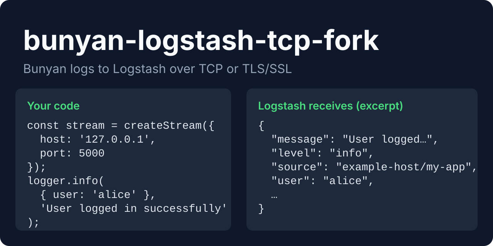
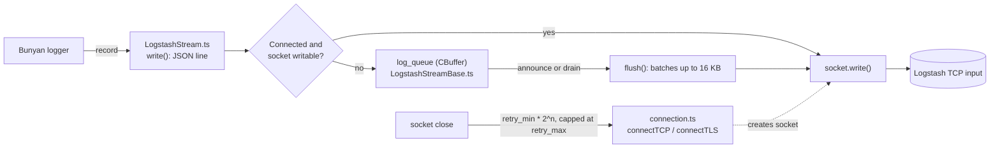

<div align="center">



# bunyan-logstash-tcp-fork

**A modern, strongly-typed [Bunyan](https://github.com/trentm/node-bunyan) stream for sending logs to Logstash via TCP or TLS/SSL.**<br/>
While Logstash is unreachable it keeps the newest `cbuffer_size` logs (10 by default), then sends queued logs in batches of up to 16 KB.

[](https://github.com/juninmd/bunyan-logstash-tcp-fork/actions/workflows/validate.yml)
[](https://badge.fury.io/js/bunyan-logstash-tcp-fork)
[](https://opensource.org/licenses/MIT)

</div>

> **Send Bunyan logs to Logstash in two steps:** install with `npm install bunyan-logstash-tcp-fork bunyan`, then pass `createStream()` to a Bunyan logger as a `raw` stream.

This package is a modernized fork designed for Node.js 18+ with full TypeScript support, robust connection handling, exponential backoff retries, and high-performance log batching.

## Why bunyan-logstash-tcp-fork

Scope: one Bunyan stream that writes JSON lines to a Logstash TCP input, with or without TLS.

- **Typed:** written in TypeScript with strict types.
- **Resilient:** reconnects with exponential backoff and buffers the newest logs while Logstash is down.
- **Encrypted when you need it:** `ssl_enable: true` switches the connection to TLS.

## Installation

Install using your preferred package manager:

```bash
npm install bunyan-logstash-tcp-fork bunyan
# or
yarn add bunyan-logstash-tcp-fork bunyan
# or
pnpm add bunyan-logstash-tcp-fork bunyan
# or
bun add bunyan-logstash-tcp-fork bunyan
```

## Usage

### TypeScript Example

```typescript
import bunyan from 'bunyan';
import { createStream } from 'bunyan-logstash-tcp-fork';

const logstashStream = createStream({
  host: '127.0.0.1',
  port: 5000,
  max_connect_retries: -1, // Retry infinitely
  retry_min: 1000, // 1 second minimum delay
  retry_max: 60000 // 60 seconds maximum delay
});

logstashStream.on('error', (err) => {
  console.error('Logstash Stream Error:', err);
});

const logger = bunyan.createLogger({
  name: 'my-app',
  streams: [
    {
      type: 'raw',
      level: 'info',
      stream: logstashStream
    }
  ]
});

logger.info({ user: 'alice' }, 'User logged in successfully');
```

Sample line received by a TCP listener for the `logger.info` call above, with `server: 'example-host'` and `appName: 'my-app'` set (by default `source` is `os.hostname()/process.title`):

```json
{"@timestamp":"2026-10-23T14:20:47.829Z","message":"User logged in successfully","tags":["bunyan"],"source":"example-host/my-app","level":"info","pid":6320,"name":"my-app","hostname":"example-host","user":"alice"}
```

### JavaScript Example (CommonJS)

```javascript
const bunyan = require('bunyan');
const { createStream } = require('bunyan-logstash-tcp-fork');

const logstashStream = createStream({
  host: 'logstash.internal.network',
  port: 5044,
  ssl_enable: true,
  ssl_key: '/path/to/key.pem',
  ssl_cert: '/path/to/cert.pem',
  ca: ['/path/to/ca.pem']
});

const logger = bunyan.createLogger({
  name: 'my-secure-app',
  streams: [
    {
      type: 'raw',
      level: 'warn',
      stream: logstashStream
    }
  ]
});

logger.warn('This log is securely transmitted over TLS.');
```

## Features

- **TypeScript Native:** Strict types for a great developer experience.
- **TCP & TLS/SSL:** Support for both standard and secure TCP connections to Logstash.
- **Reliability:** Built-in connection retries with exponential backoff and connection state management.
- **Performance:** Implements log batching, circular buffering for offline logs, and optimized JSON serialization using `fast-safe-stringify`.
- **Modern Syntax:** Refactored strictly adhering to Clean Code, SOLID, DRY, and KISS principles without legacy code to maintain low overhead and high performance. Linted with `Biome`.

## Configuration Options

When calling `createStream(options)`, the following configuration options are available:

| Option | Type | Default | Description |
|---|---|---|---|
| `host` | `string` | `'127.0.0.1'` | Logstash server hostname or IP address. |
| `port` | `number` | `9999` | Logstash server TCP port. |
| `max_connect_retries` | `number` | `4` | Max reconnection attempts. Use `-1` for infinite retries. When exceeded, the stream enters a permanent silent mode to prevent memory leaks. |
| `retry_min` | `number` | `100` | Minimum wait time (in ms) before retrying a connection (starts exponential backoff). |
| `retry_max` | `number` | `10000` | Maximum wait time (in ms) between connection retries. |
| `cbuffer_size` | `number` | `10` | Number of unwritten log messages to buffer while offline before dropping the oldest logs. |
| `level` | `string` | `'info'` | Stored on the stream but not used for filtering. Set `level` on the Bunyan stream entry instead. |
| `appName` | `string` | `process.title` | Name of the application (adds `source` field). |
| `server` | `string` | `os.hostname()` | Name of the server (adds `source` field). |
| `pid` | `number` | `process.pid` | Process ID. |
| `tags` | `string[]` | `['bunyan']` | Logstash tags to attach to every payload. |
| `type` | `string` | `undefined` | Logstash `type` field value. |
| `ssl_enable` | `boolean` | `false` | Enable TLS/SSL connection to Logstash. |
| `ssl_key` | `string` | `''` | File path to the SSL private key. |
| `ssl_cert` | `string` | `''` | File path to the SSL certificate. |
| `ca` | `string[] \| string` | `''` | File path(s) to the Certificate Authority bundle. |
| `ssl_passphrase` | `string` | `''` | Passphrase used for the SSL private key, if applicable. |

## How it works



### Network Behavior

- **TCP Keep-Alive:** The stream actively uses TCP Keep-Alive to detect dead connections and proactively attempt reconnections.
- **Buffering & Backpressure:** Logs sent while the stream is disconnected are buffered in a FIFO `CBuffer` up to `cbuffer_size`. The stream correctly monitors `socket.write` returns; if the socket buffer fills up, it waits for the `drain` event before flushing the rest of the queue, effectively handling backpressure.
- **Batching:** Flushes transmit buffered logs using chunking (batch sizes up to ~16KB) to improve throughput and reduce underlying system calls.
- **Reconnects:** It uses an exponential backoff strategy calculated as `retry_min * (2 ** retries)`, capped at `retry_max`. If retries exceed `max_connect_retries` (and it's not set to `-1`), the stream halts gracefully, stopping further attempts and ignoring subsequent writes to avoid boundless memory exhaustion.

## Develop

Requires Node.js 18+ (`.nvmrc` pins 18) and Yarn 1 (`yarn.lock` is v1 format).

```bash
yarn install --frozen-lockfile   # install from yarn.lock; the prepare script also runs the build
yarn run build                   # compile src/ to dist/ with tsc
yarn run lint                    # Biome check on src/ (yarn run lint:fix applies fixes)
yarn run mocha                   # run the compiled tests in dist/test/
yarn test                        # lint, then mocha under nyc with coverage
```

## Contributing

Open pull requests against `master`. Guidelines are in [AGENTS.md](AGENTS.md).

## Security

- Logs are sent in plain text unless `ssl_enable` is `true`.
- With `ssl_enable`, the connection uses Node's `tls.connect` with the options you pass. No `rejectUnauthorized` override exists in `src/connection.ts`, so Node's default certificate verification applies; use `ca` to point at a private CA bundle.

## Known limitations

- **Best-effort delivery.** The stream never reads from the socket, so it does not wait for or check acknowledgements from Logstash.
- **Bounded offline buffer.** While disconnected, only the newest `cbuffer_size` entries are kept; older ones are overwritten.
- **Permanent stop after retries.** Once `max_connect_retries` is exhausted, the stream stays silent for the rest of the process and clears its buffer.
- **Synchronous certificate loading.** `ssl_key`, `ssl_cert` and `ca` files are read with `readFileSync` when the stream is created.
- **Test scripts need POSIX env syntax.** `yarn test` and `yarn run coverage` set `LOGGER_LEVEL=fatal` inline, which fails under `cmd.exe` on Windows (not checked in other Windows shells).

## License

[MIT](LICENSE.md). Copyright © 2014 Christoph Hartmann, see [LICENSE.md](LICENSE.md).
